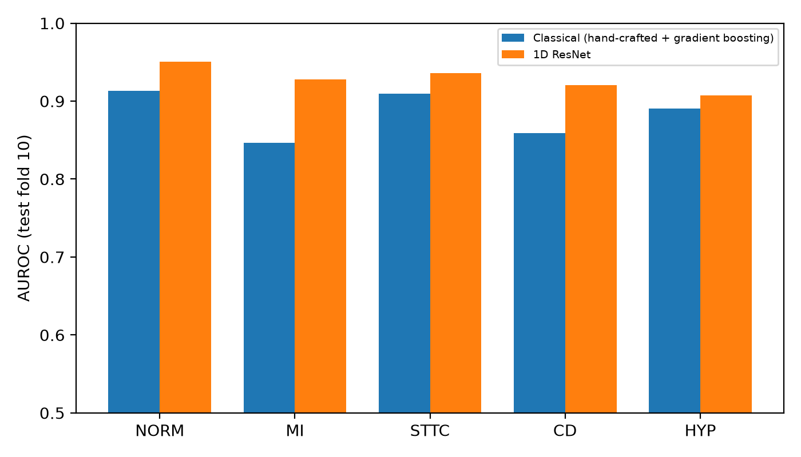
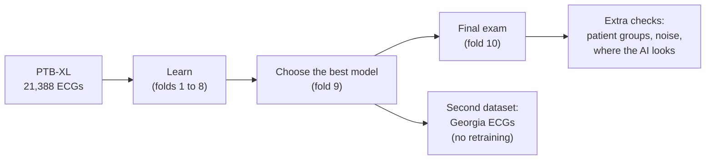
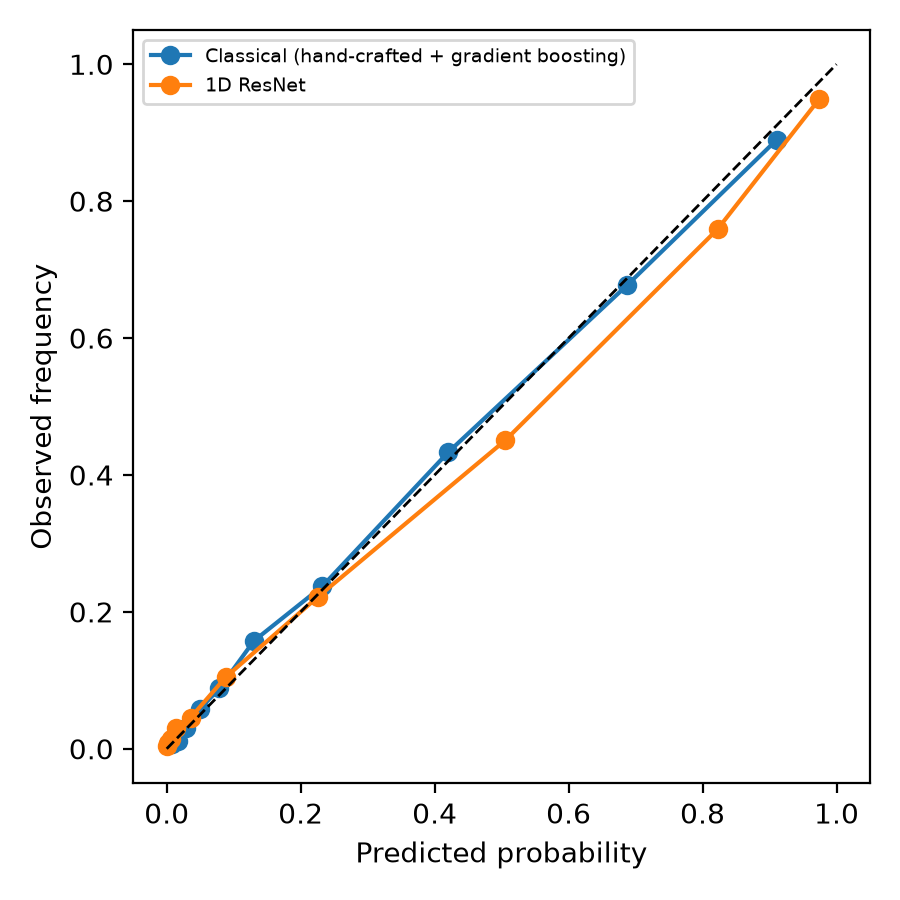
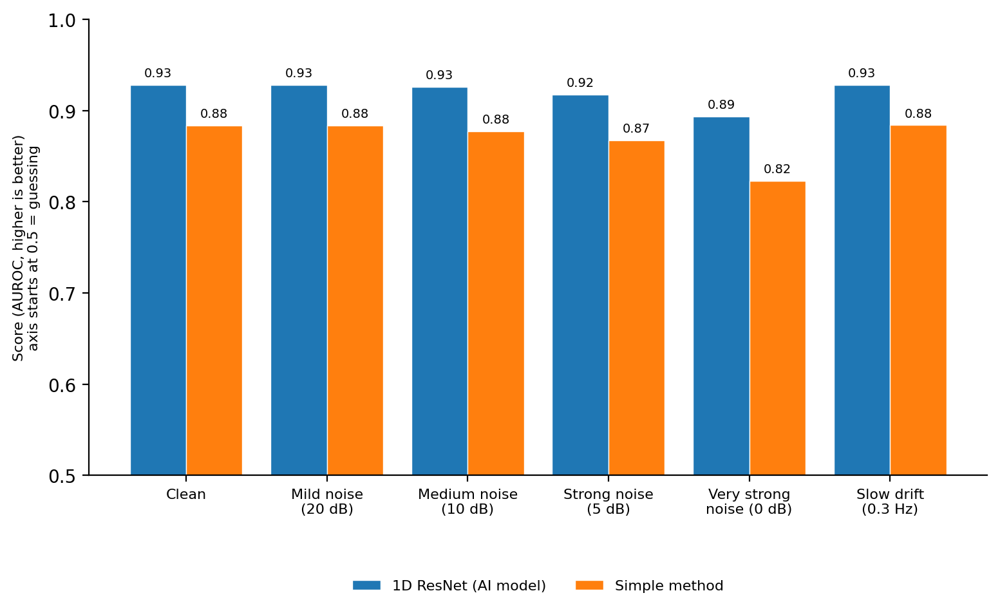
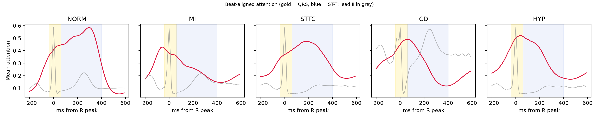
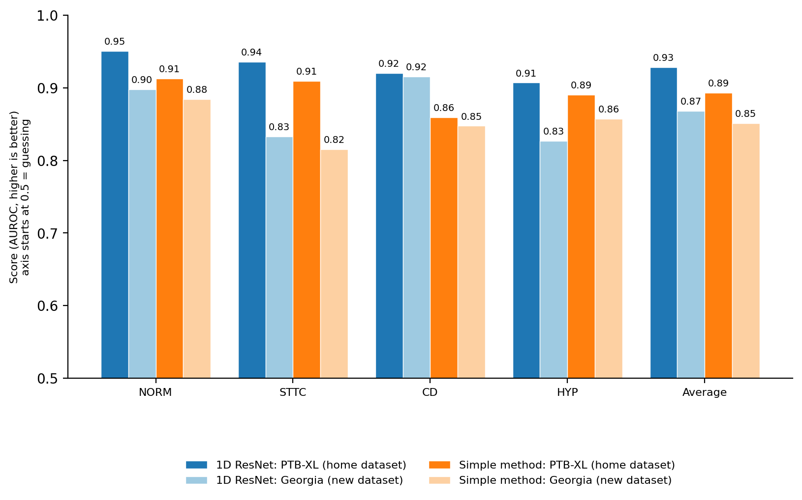

# Can an AI Read an ECG, and Can We Trust *How* It Reads It?

*A physiology-led study. Built on 21,388 ECGs, then tested on 6,947 more from a different source it had never seen.*

**Live demo:** coming soon · **DOI:** assigned at first release · **Preprint:** in preparation


[](https://github.com/ajibola-analyst/ptbxl-ecg-physiology-interpretability/actions)


> [!IMPORTANT]
> This is a research prototype. It is **not** a medical device.

**Author:** Ajibola Odeyemi · BSc Physiology, LAUTECH · Specialist in Quantitative & Qualitative Analytics
[ORCID](https://orcid.org/0009-0007-9924-1216) · [GitHub](https://github.com/ajibola-analyst)

---


## In one minute

An **ECG** is a recording of the heart's electrical signals. Doctors read it to spot problems such as a heart attack.

I built an AI model that reads ECGs. But I did not stop at "how accurate is it?" As a physiologist, I asked two harder questions:

1. **Does it look at the parts of the heartbeat that actually matter?**
2. **Does it still work on a dataset it has never seen?**

### The answers at a glance

| What I asked | Short answer | Key number |
|---|---|---|
| How accurate is the AI? | Accurate, and better than a simpler method | **0.928** (simple method: 0.884) |
| Does it work for every patient group? | Mostly. Weaker for patients aged 75 and over | 0.898 for ages 75+ |
| Does it cope with noisy recordings? | Yes, and better than the simpler method | Lost 0.035 at very strong noise (simple method: 0.061) |
| Does it look at the right parts of the heartbeat? | Mostly yes, with one surprise for heart attacks | See [Section 5](#5-where-does-the-ai-look) |
| Does it work on a new dataset? | Less well, but it still came out ahead | **0.868** (down from 0.928) |
| Can its probabilities be trusted on a new dataset? | Not without adjustment | Error rose from 0.016 to 0.083 |
| Was heart attack tested on the new dataset? | No. There were too few cases | 7 cases |

> [!NOTE]
> **How to read the scores.** Every score here is called AUROC. Picture one ECG that has a condition and one that does not. The score is how often the AI gives the higher probability to the right one.
> **0.5 = a coin toss. 1.0 = perfect.** A score of 0.93 means about 93 pairs out of 100 are ranked correctly.



---

## What I did

I used a public collection of clinical ECGs called **PTB-XL**. Each ECG was sorted into five groups:

| Group | What it means |
|---|---|
| **NORM** | Normal ECG |
| **MI** | Heart attack (myocardial infarction) |
| **STTC** | Changes in the ST segment or T wave |
| **CD** | Conduction disturbance: the electrical signal travels slowly or gets blocked |
| **HYP** | Hypertrophy: thickened heart muscle |

One ECG can belong to more than one group.

I built two models and compared them:

- **The simple method:** it measures things a person could measure, such as heart rate and wave heights, then makes a prediction.
- **The AI model (a 1D ResNet):** it reads the raw signal and learns its own patterns.



The same patient never appears in two folds. The final-exam fold was never used to choose anything.

### A heartbeat has three parts that matter here

| Part | What it is |
|---|---|
| **QRS** | The sharp spike. The main pumping signal |
| **ST segment** | The short flat stretch right after the spike |
| **T wave** | The rounded bump. The heart resetting for the next beat |

---

## What I found

### 1. How accurate is the AI?

**Answer: accurate, and clearly better than the simple method.**

| Model | Score (95% confidence range) |
|---|---|
| Simple method | 0.884 (0.874 to 0.893) |
| **AI model (1D ResNet)** | **0.928 (0.921 to 0.935)** |

The two ranges do not overlap, so the gap is not luck. The AI gained most for heart attack (**0.847 to 0.928**). It gained least for HYP (0.891 to 0.907), where the ranges overlap.

### 2. Can we trust the probabilities it gives?

**Answer: mostly, on the data it learned from.**

When the AI says "70% likely", is it right about 70% of the time? I checked.



The simple method was slightly more honest (average gap 0.011, against 0.020 for the AI). The AI was a little **over-confident** in the middle-to-high range. This matters again in Section 6.

### 3. Does it work for every kind of patient?

**Answer: mostly. It was weaker for patients aged 75 and over.**

| Group | Patients | Simple method | AI model |
|---|---|---|---|
| Men | 1,110 | 0.892 | 0.937 |
| Women | 1,048 | 0.874 | 0.919 |
| Under 40 | 284 | 0.874 | 0.923 |
| 40 to 59 | 639 | 0.870 | 0.929 |
| 60 to 74 | 706 | 0.876 | 0.924 |
| **75 and over** | 529 | 0.847 | **0.898** |

Both models did worse for the oldest group and slightly worse for women. These groups are small and I did not calculate confidence ranges for them, so I do not claim these gaps are certain.

### 4. Does it cope with noisy recordings?

**Answer: yes, and better than the simple method.**

I added computer-made noise to every test ECG. At the extreme, the noise was as strong as the heartbeat signal itself.



At that extreme, the AI lost **0.035** and the simple method lost **0.061**. A slow up-and-down drift (like the movement caused by breathing) changed almost nothing. This noise was made by computer, so real-world noise may behave differently.

### 5. Where does the AI look?

**Answer: mostly at the heartbeat itself, but not always where I expected.**

I used a method called **Grad-CAM**. Think of it as a highlighter. It marks the moments in a recording that pushed the AI towards its answer. I lined up every heartbeat on its spike and averaged the highlights.



*Red line: average attention. Grey line: a typical heartbeat. Gold: the QRS. Blue: the ST segment and T wave.*

The table compares the AI's attention with an even spread. **1.0 means even. Above 1.0 means more attention than chance.**

| Group | QRS | ST segment | T wave | Gaps between waves |
|---|---|---|---|---|
| NORM | 1.25 | 1.46 | **1.58** | 0.43 |
| MI | **1.51** | 1.17 | 0.81 | 0.90 |
| STTC | 1.16 | **1.40** | 1.24 | 0.67 |
| CD | **1.57** | **1.51** | 0.66 | 0.83 |
| HYP | **1.54** | **1.49** | 0.86 | 0.74 |

**What fits physiology**

- **For all five groups, the AI paid less attention to the gaps between waves than an even spread would give** (0.43 to 0.90). It is not staring at empty stretches.
- **STTC:** above 1.0 on the ST segment and T wave. That matches its name.
- **CD:** highest on the QRS. Conduction problems can widen the QRS.
- **HYP:** strongest around the QRS. Thickened muscle changes the size of the QRS.
- **NORM:** the T wave got the most attention.

**The surprise**

- **For heart attack (MI), I expected the ST segment to matter most. It did not.** The QRS was highest (1.51). The ST segment was only 1.17. The T wave was below even (0.81). The MI peak sits just *before* the spike, near the start of the QRS. That is where pathological Q waves, a known sign of infarction, appear. This may explain it, but **I did not test it**.

I report this as it came out. A result that only confirmed my expectations would teach me less.

### 6. Does it still work on a new dataset?

**Answer: less well, and the AI lost more than the simple method. It still came out ahead overall.**

Both models learned only from PTB-XL. I then tested them, unchanged, on ECGs from the **Georgia database**, a collection from the Southeastern United States. Nothing was retrained or adjusted.

Georgia has almost no heart-attack cases (7), so I could test four of the five groups. Each cell shows the score on PTB-XL (home), then on Georgia (the new dataset), then the change.

| Group | AI model | Simple method |
|---|---|---|
| NORM | 0.951 → 0.898 (−0.053) | 0.913 → 0.885 (−0.028) |
| STTC | 0.936 → 0.833 (−0.103) | 0.909 → 0.815 (−0.094) |
| CD | 0.920 → 0.916 (**−0.005**) | 0.859 → 0.847 (−0.012) |
| HYP | 0.907 → 0.827 (−0.080) | 0.891 → 0.857 (−0.033) |
| **Average** | **0.928 → 0.868 (−0.060)** | **0.893 → 0.851 (−0.042)** |



**What this shows**

- **The AI's lead shrank by about half.** On the four groups, it was 0.035 ahead at home (0.928 vs 0.893) and 0.017 ahead on the new dataset (0.868 vs 0.851).
- **It held up best for conduction disturbance (CD)**, with almost no change (−0.005).
- **ST-T changes (STTC) fell most** (−0.103). Different sources may label these findings differently, since STTC was far more common in the Georgia sample (49%) than in PTB-XL (24.5%). I did not test this.
- **For hypertrophy (HYP), the simple method won on the new dataset** (0.857 vs 0.827). At home it was the other way round.
- **Probabilities got much less trustworthy.** The average gap between stated and actual probability rose from 0.016 to 0.083 for the AI (and from 0.012 to 0.068 for the simple method). A different mix of conditions probably plays a part. I did not recalibrate. Any real use would need that first.
- **The result does not depend on my label matching.** With a stricter set of labels (5,489 ECGs), the AI scored 0.871 (change −0.058), almost the same.

**What is missing:** heart attack (MI) was **not tested** outside PTB-XL. Its result rests on one dataset.

---

## What I did not prove

I want to be clear about the limits.

**About the data**
- **PTB-XL is one dataset.** It was curated by Germany's PTB institute from recordings made between 1989 and 1996 on a small set of device types. I tested on one other source (Georgia). Two sources are better than one, but they do not prove the model works everywhere.
- **Heart attack (MI) has no outside test.** Georgia has too few cases.

**About the labels**
- **Labels come from reports**, written by cardiologists or ECG machines. They were not confirmed by scans.
- **The two datasets label ECGs differently.** I matched them using official code tables and checked with a stricter set. Some of the drop in Section 6 probably comes from labelling, not from the model.
- **ECGs with an unclear label were left out of the Georgia test** (3,335 of 10,282). That includes ECGs with a prolonged-QT label, which is far more common in Georgia than in PTB-XL and suggests different labelling habits.

**About the methods**
- **Georgia's confidence ranges are slightly too narrow.** The files have no patient IDs, so I resampled ECGs, not patients.
- **I converted Georgia from 500 Hz to 100 Hz myself.** PTB-XL's 100 Hz files were made in a different way.
- **The simple method was not tuned.** Part of the gap between the two models may come from that.
- **The patient-group results have no confidence ranges.**
- **The attention analysis is a rough guide.**
  - It uses only ECGs the AI got right (up to 200 per group).
  - The timing windows are fixed. They do not follow each person's real wave timing.
  - The highlighter is blurry. One step covers about 80 milliseconds.
  - It shows *when* the AI looked, not *which lead*.
  - It shows where the evidence lies. It does not prove how the AI reasons.

**About use**
- **This is not a medical device.** It has not been tested on patients.

---

## What I would do next

1. Test heart attack (MI) on a source that has enough cases.
2. Recalibrate the probabilities, then test again on a new dataset.
3. Tune the simple method, for a fairer comparison.
4. Add confidence ranges for the patient-group results.
5. Study the AI's attention lead by lead, not only over time.
6. Test whether the heart-attack attention near the Q wave is real.

---

## Run it yourself

You need Python 3.11 or newer and the PTB-XL data. Get it at https://doi.org/10.13026/kfzx-aw45

```powershell
git clone https://github.com/ajibola-analyst/ptbxl-ecg-physiology-interpretability
cd ptbxl-ecg-physiology-interpretability
python -m venv .venv
.\.venv\Scripts\Activate.ps1
pip install -r requirements.txt
```

Put `records100/`, `ptbxl_database.csv` and `scp_statements.csv` in `data/ptbxl/`. Then run the main project:

```powershell
.\run_all.ps1
```

For the second-dataset test, run this afterwards (about 1.3 GB of extra data):

```powershell
.\run_external.ps1
```

To try the small demo app: `streamlit run app/streamlit_app.py`

The random seed is fixed at 42. Results on a graphics card may differ slightly.

---

<details>
<summary><strong>For technical readers: methods, full tables and data counts</strong></summary>

### Data

| | PTB-XL (main data) | Georgia (second dataset) |
|---|---|---|
| Role | Training, model choice, final exam | Testing only |
| Size | 21,799 ECGs, 18,869 patients; 21,388 kept (at least one of the five labels) | 10,344 ECGs in the database |
| Source | Curated by PTB (Germany); 1989–1996; Schiller devices; 51 pseudonymised recording sites | Georgia 12-Lead ECG Challenge Database, PhysioNet/Computing in Cardiology Challenge 2020 (Southeastern United States) |
| Format used | 100 Hz, 12 leads, 10 s | 500 Hz, converted to 100 Hz, 12 leads, 10 s |
| Licence | CC BY 4.0 | See the dataset page |

**From the Georgia database to the test**

| Step | ECGs |
|---|---|
| In the database | 10,344 |
| Downloaded (10 failed repeatedly) | 10,334 |
| Full 10 seconds long (52 were shorter) | 10,282 |
| Label matched to the five groups | 6,947 |
| Strict label set (direct equivalents only) | 5,489 |

Positives in the 6,947: NORM 1,733 · MI 7 · STTC 3,423 · CD 1,885 · HYP 1,164. A group is tested only with at least 50 positive and 50 negative ECGs, so MI was not tested.

**How Georgia labels were matched** (full list in `src/external_mapping.py`)

| Group | Georgia label used |
|---|---|
| NORM | Sinus rhythm as the *only* label |
| CD | Bundle branch blocks, fascicular blocks, AV blocks, non-specific conduction disorder |
| HYP | Ventricular or atrial hypertrophy or abnormality |
| STTC | T-wave abnormal, non-specific ST-T abnormality, ischaemia, ST depression or elevation |
| MI | Myocardial infarction codes (too few records to test) |

Prolonged QT (SNOMED 111975006) is excluded because it is far more common in Georgia (1,391 of 10,344) than in PTB-XL (118 of 21,837), by the official Challenge tables.

### Methods

| Part | Detail |
|---|---|
| Split | Official PTB-XL stratified folds: 1–8 train, 9 validation, 10 test. Patient-wise |
| Normalisation | Per-lead mean and standard deviation from the training folds only |
| Simple method | Heart rate, SDNN, RMSSD, R-width proxy, per-lead statistics, beat-locked R-amplitude, ST-deviation and T-wave proxies. Gradient boosting, one model per class, fixed settings |
| AI model | 1D ResNet, four residual stages, 970,437 parameters, dropout 0.3, BCE loss, AdamW (learning rate 1e-3, weight decay 0.01), cosine schedule, batch size 64, 25 epochs |
| Model choice | Best validation macro AUROC: epoch 14 (0.932). Validation then drifted to 0.923 by epoch 25 while training loss fell from 0.335 to 0.125 (overfitting), so the epoch-14 model was used. The test score (0.928) is close to the validation peak |
| Uncertainty | Patient-level bootstrap, 1,000 resamples |
| Noise | Gaussian noise at 20, 10, 5, 0 dB SNR (relative to each recording's own power); sinusoidal baseline wander at 0.3 Hz |
| Attention | Grad-CAM on the last residual stage, aligned to R peaks (−200 to +600 ms). Windows: QRS −40 to +60 ms, ST/early T +60 to +200 ms, T wave +200 to +400 ms, rest = gaps. Enrichment = share of attention ÷ share of time. Only test ECGs with the true label and predicted probability above 0.5 were used |
| Second dataset | Headers parsed to read gain and baseline per lead; signals converted to millivolts, reordered to PTB-XL lead order by name, resampled with a polyphase filter (`resample_poly`, 1/5), first 10 s kept, PTB-XL normalisation applied, nothing refitted. A sanity check compares per-lead signal spread with PTB-XL (ratios 0.79 to 1.05). Record-level bootstrap, 1,000 resamples |
| Software | Developed and run on Python 3.14.3 (Windows 11). Automated tests are also set up for Python 3.11 on GitHub |

### Per-class AUROC on PTB-XL fold 10 (95% CI)

| Model | NORM | MI | STTC | CD | HYP |
|---|---|---|---|---|---|
| Simple method | 0.913 (0.900–0.924) | 0.847 (0.827–0.864) | 0.909 (0.895–0.922) | 0.859 (0.837–0.881) | 0.891 (0.869–0.909) |
| AI model | 0.951 (0.942–0.959) | 0.928 (0.915–0.939) | 0.936 (0.924–0.946) | 0.920 (0.903–0.937) | 0.907 (0.888–0.925) |

| Model | Macro AUPRC | Mean Brier | ECE (pooled) |
|---|---|---|---|
| Simple method | 0.738 | 0.104 | 0.011 |
| AI model | 0.823 | 0.083 | 0.020 |

### Noise test (macro AUROC)

| Condition | Simple method | AI model |
|---|---|---|
| Clean | 0.884 | 0.928 |
| Gaussian noise, 20 dB | 0.884 | 0.928 |
| Gaussian noise, 10 dB | 0.877 | 0.926 |
| Gaussian noise, 5 dB | 0.867 | 0.918 |
| Gaussian noise, 0 dB | 0.823 | 0.894 |
| Baseline wander, 0.3 Hz | 0.884 | 0.928 |

### Second dataset (Georgia), with 95% CI

| Group | AI model | Simple method |
|---|---|---|
| NORM | 0.898 (0.889–0.906) | 0.885 (0.877–0.893) |
| STTC | 0.833 (0.824–0.842) | 0.815 (0.805–0.826) |
| CD | 0.916 (0.909–0.923) | 0.847 (0.837–0.858) |
| HYP | 0.827 (0.814–0.839) | 0.857 (0.846–0.868) |
| Average | 0.868 (0.864–0.874) | 0.851 (0.846–0.857) |
| Average, strict labels | 0.871 (0.865–0.876) | 0.845 (0.839–0.852) |

Calibration error (ECE) on the four groups: AI 0.016 → 0.083, simple method 0.012 → 0.068.

### Grad-CAM sample sizes

NORM 200 ECGs (2,159 beats) · MI 200 (2,150) · STTC 200 (2,285) · CD 200 (2,134) · HYP 135 (1,559).

### Project map

```text
ptbxl-ecg-physiology-interpretability/
├── app/        Streamlit demo (research use only)
├── data/       Data instructions (data not included)
├── figures/    Charts used in this README
├── models/     Trained model files (rebuilt by the pipeline)
├── results/    Every number: metrics, noise tests, attention, second dataset
├── src/        Code: data, features, model, training, evaluation, Grad-CAM, second-dataset test
├── tests/      Automatic tests (14)
├── CITATION.cff
├── requirements.txt
└── README.md
```

All raw numbers are in `results/`. The full second-dataset tables are in `results/external_georgia.md`.

</details>

<details>
<summary><strong>Quick glossary</strong></summary>

| Term | Plain meaning |
|---|---|
| ECG | A recording of the heart's electrical signals |
| AUROC | A score from 0.5 (coin toss) to 1.0 (perfect) for how well a model ranks sick above healthy |
| Confidence range (95% CI) | The range the true score probably lies in. Narrow means more certain |
| Calibration | Whether the probabilities a model states match how often it is right |
| Grad-CAM | A "highlighter" that shows which moments of a recording influenced the AI |
| Second-dataset test (external validation) | Testing a model on data from a different source, with no retraining |
| QRS, ST segment, T wave | The three parts of a heartbeat described above |

</details>

---

## Related work

[Sepsis Early Warning: External Validation Across Hospital Systems](https://github.com/ajibola-analyst/sepsis-early-warning-external-validation)

## Credits and licence

If you use this work, please cite the datasets and this repository (see `CITATION.cff`).

- Wagner P. et al. (2022). *PTB-XL, a large publicly available electrocardiography dataset* (v1.0.3). PhysioNet. https://doi.org/10.13026/kfzx-aw45
- Wagner P. et al. (2020). PTB-XL, a large publicly available ECG dataset. *Scientific Data*. https://doi.org/10.1038/s41597-020-0495-6
- Perez Alday E. A. et al. (2020). Classification of 12-lead ECGs: the PhysioNet/Computing in Cardiology Challenge 2020. *Physiological Measurement*. https://doi.org/10.1088/1361-6579/abc960
- Perez Alday E. A. et al. (2022). *Classification of 12-lead ECGs: the PhysioNet/Computing in Cardiology Challenge 2020* (v1.0.2). PhysioNet. https://doi.org/10.13026/dvyd-kd57
- Strodthoff N. et al. (2021). Deep learning for ECG analysis: benchmarks and insights from PTB-XL. *IEEE JBHI* 25(5):1519–1528.
- Selvaraju R. R. et al. (2017). Grad-CAM: visual explanations from deep networks via gradient-based localization. *ICCV*.
- Pollard T. et al. (2026). PhysioNet as a global platform for biomedical research. *Nature Health*. https://doi.org/10.1038/s44360-026-00096-z

Code is released under the MIT Licence. The datasets stay under their own licences and are not redistributed here.
